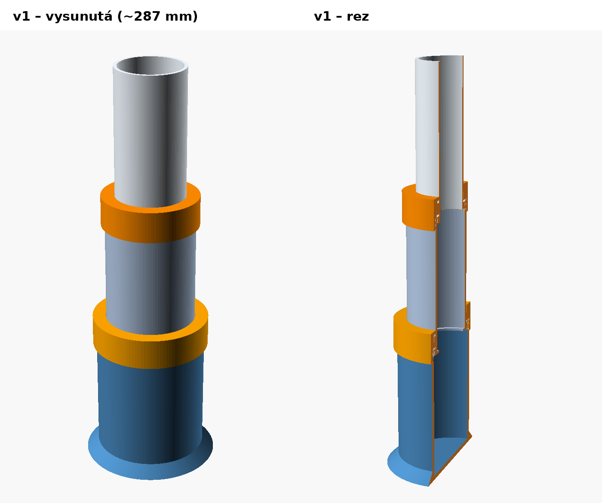
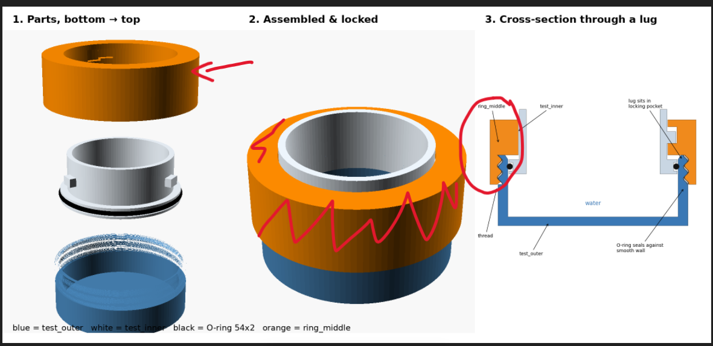
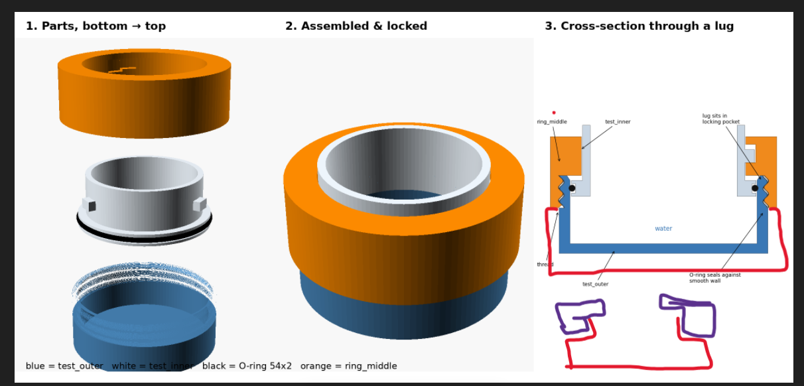
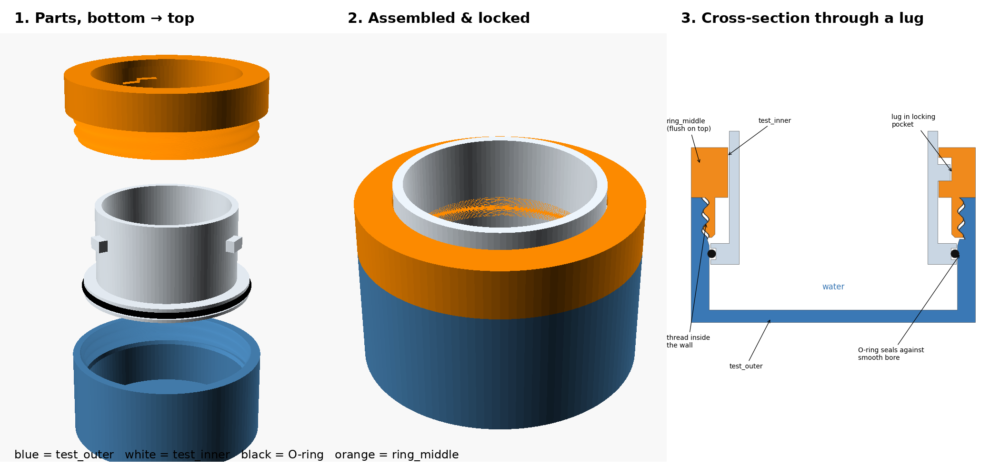
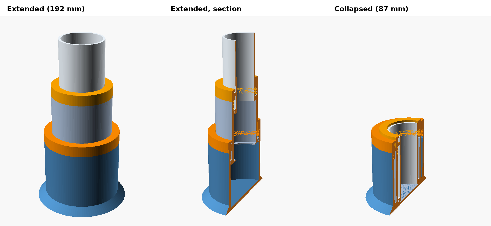
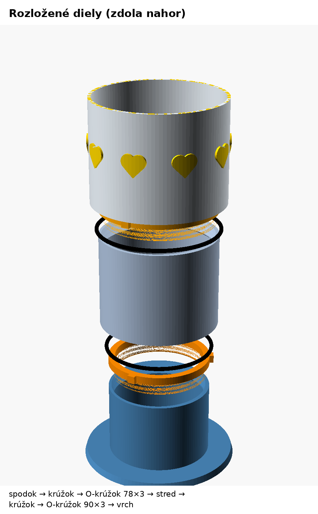
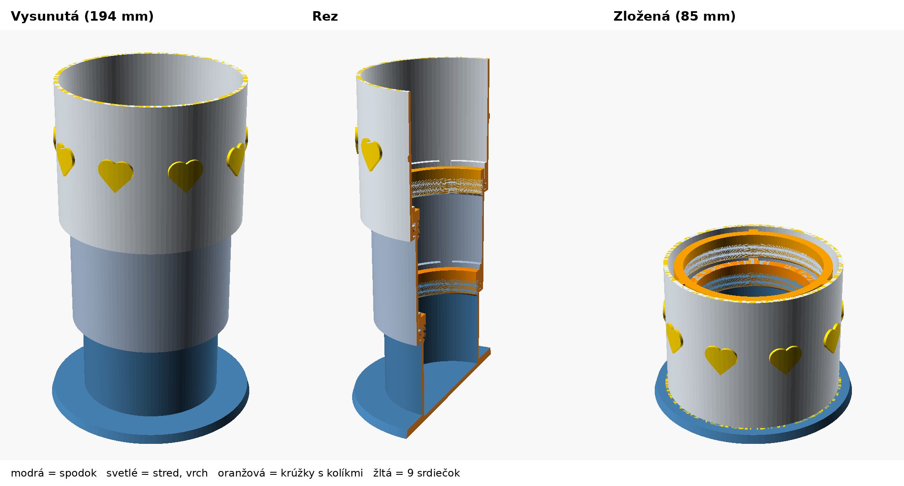
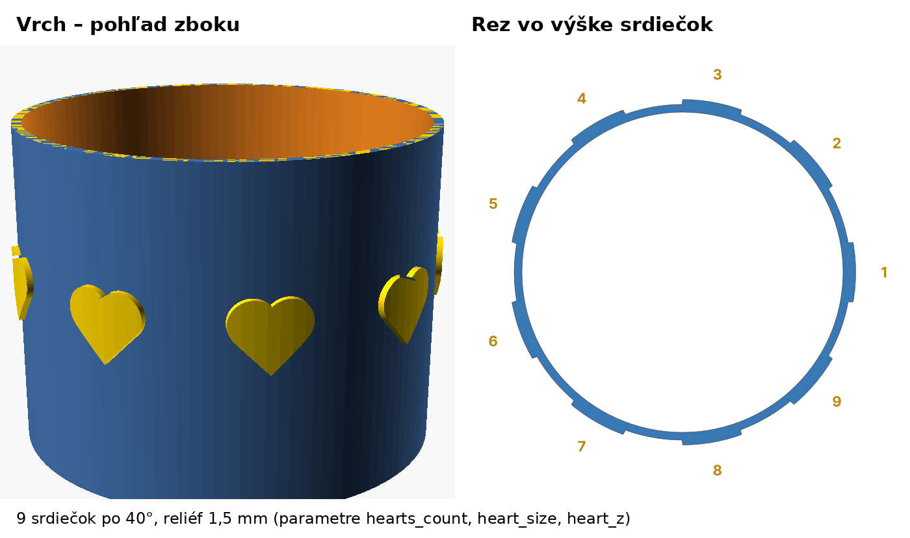

---
# 🧩 Versioning – systém dopĺňa automaticky
fm_version: "1.0.1"

# Dátum buildu – generuje skript
fm_build: ""

# Poznámka k verzii – voliteľné
fm_version_comment: "Návrh v2 – krúžok zarovno, max. výška 200 mm"

# 🆔 IDENTITY --------------------------------------------------------

# ID generuje CLI / skript
id: "K000100"

# Unikátne UUID – generuje skript
guid: ""

# 🧭 CONTEXT ---------------------------------------------------------

# DAO / doména (knife, sdlc, q12, 7ds...) dopĺňa skript
dao: "knife"

# Názov zápisu – dopĺňa používateľ
title: "Teleskopická váza s bajonetovým zámkom"

# Krátky popis – dopĺňa používateľ (voliteľné)
description: "Semestrálny projekt SMVIT – vodotesná teleskopická váza z 3D tlačiarne s bajonetovým zámkom a O-krúžkami, od nápadu cez iterácie návrhu po testovaciu sadu."

# 👥 AUTHORSHIP ------------------------------------------------------

# Hlavný autor – z globálneho configu
author: "Vojtech Babinský"

# Zoznam autorov – generuje skript
authors:
  - "Vojtech Babinský"

# 🗂 CLASSIFICATION ---------------------------------------------------

# Nadradená kategória – môže doplniť používateľ
category: "fablab"

# Typ dokumentu (guide, case, tutorial...) – používateľ (voliteľné)
type: "case-study"

# Priorita (low/medium/high) – voliteľné
priority: ""

# Tagy – odporúča sa 2–6 tagov.
tags:
  - knife
  - case-study
  - 3d-tlac
  - cad
  - fablab
  - intermediate

# 🌍 LOCALIZATION -----------------------------------------------------

# Jazyk dokumentu – doplní skript podľa štruktúry
locale: "sk"

# 🕒 LIFECYCLE --------------------------------------------------------

# Dátum vytvorenia – generuje skript
created: "2026-10-20 17:30"

# Dátum poslednej úpravy – dopĺňa človek
modified: "2026-10-20 17:30"

# Stav dokumentu – default "backlog"
status: "in-progress"

# Viditeľnosť – default "public"
privacy: "public"

# ⚖ INTELLECTUAL PROPERTY -------------------------------------------

# Držiteľ práv k obsahu – dopĺňa skript
rights_holder_content: "Vojtech Babinský"

# Systémový vlastník práv
rights_holder_system: "CAA / KNIFE / LetItGrow"

# Licencia
license: "CC-BY-NC-SA-4.0"

# Disclaimer
disclaimer: "Use at your own risk. Methods provided as-is; participation is voluntary and context-aware."

# Copyright
copyright: "© 2026 Vojtech Babinský"

# 🔗 ORIGIN / PROVENANCE ---------------------------------------------

# Repozitár pôvodu
origin_repo: ""

# URL pôvodného repozitára
origin_repo_url: ""

# Commit pôvodu
origin_commit: ""

# Branch pôvodu
origin_branch: ""

# Systém pôvodu (CAA/KNIFE/STHDF…)
origin_system: "CAA"

# Pôvodný autor
origin_author: "Vojtech Babinský"

# Importovaný zdroj
origin_imported_from: ""

# Dátum importu
origin_import_date: ""

# 🧱 RESERVED ---------------------------------------------------------

fm_reserved1: ""
fm_reserved2: ""
---

# 🏺 Teleskopická váza s bajonetovým zámkom

## 🎯 Čo rieši (účel, cieľ)

Bežná váza má jednu pevnú výšku: na krátke kvety je privysoká, na dlhé
prinízka a pri skladovaní či prenášaní zaberá zbytočne veľa miesta. Cieľom
projektu je **malá, ale plne funkčná váza z 3D tlačiarne**, ktorá sa dá
vysunúť a zasunúť ako ďalekohľad, v každej polohe drží pevne a hlavne
**nepreteká**.

Požiadavky na začiatku projektu:

- teleskopická konštrukcia (viac segmentov do seba),
- zaistenie segmentov **bajonetovým zámkom**,
- tesnenie **gumenými O-krúžkami**,
- vysunutá výška **najviac 20 cm**,
- možnosť vázu dekorovať (potlač, nálepka, reliéf).

## 🧩 Ako to rieši (princíp)

Váza má **tri segmenty** (spodok s dnom, stred, vrch) a **dva bajonetové
krúžky**. Každý spoj funguje rovnako:

- **Tesnenie** – na spodku vnútorného segmentu je golier s drážkou pre
  O-krúžok. Krúžok tesní radiálne o hladké vnútorné vŕtanie vonkajšieho
  segmentu. Voda zostáva pod tesnením.
- **Bajonet** – vnútorný segment má 3 kolíky po 120°. V krúžku sú L-drážky
  s poistným lôžkom: po pootočení o 30° kolík padne o 1 mm nižšie, takže sa
  zámok sám neodkrúti.
- **Krúžok so závitom** – bajonetové drážky nie sú priamo v stene segmentu
  (prerušili by tesniacu plochu), ale v samostatnom krúžku, ktorý sa
  zaskrutkuje do segmentu. Krúžok zároveň umožňuje vázu poskladať, rozobrať
  a vymeniť O-krúžky.

Celý model je **parametrický** (OpenSCAD) – všetky rozmery sú premenné, takže
zmena výšky, priemeru alebo vôle je otázka jedného čísla a nového exportu.

## 🧪 Ako to použiť (aplikácia)

1. Vytlačiť a overiť **testovaciu sadu** (krátky kus spoja) – tesnosť a chod
   bajonetu za zlomok materiálu.
2. Podľa testu doladiť vôľu (`clr`) a vyexportovať STL.
3. Vytlačiť segmenty a krúžky z PETG.
4. Nasadiť O-krúžky, vložiť segmenty do seba a naskrutkovať krúžky.
5. Vysunúť, pootočiť o 30° – zamknuté.

---

## ⚡ Rýchly návod (Top)

| Čo                                            | Hodnota                                          |
| --------------------------------------------- | ------------------------------------------------ |
| 📏 Výška vysunutá / zložená                   | 194 mm / 85 mm                                   |
| ⭕ Priemery (v3)                              | vrch vnútri 98,8 / stred 91,8 / spodok 80 mm, pätka 120 mm |
| 🧱 Diely na tlač                              | bottom, middle, top, ring_bottom, ring_middle    |
| 🔴 O-krúžky (NBR 70 Shore A)                  | 78×3 mm (spodok–stred), 90×3 mm (stred–vrch)     |
| 💛 Dekorácia                                  | reliéf 1,5 mm na vrchu, parameter `motif` (aj vlastné SVG) |
| 🔒 Bajonet                                    | 3 kolíky, pootočenie 30°, poistka 1 mm           |
| 🧵 Materiál                                   | PETG, 4–6 perimetrov, segmenty postojačky        |
| 🧪 Testovacia sada (v3)                       | test_lower + ring_bottom + test_upper + O-krúžok 78×3 |
| 🛠️ Nástroje                                   | OpenSCAD (model), PrusaSlicer / Cura (tlač)      |

## 📜 Detailný článok

### 1. Nápad a prvý koncept

Pôvodný nápad bol jednoduchý: váza z niekoľkých rúrok, ktoré sa zasúvajú do
seba a zaisťujú bajonetom. Hneď na začiatku sa ukázal prvý konflikt:
ak by boli bajonetové drážky vyrezané priamo vo vnútornej stene segmentu,
kolíky by po nich museli prejsť celou dĺžkou a drážka by **prerušila plochu,
o ktorú tesní O-krúžok** – voda by vytiekla drážkou.

Riešenie: drážky presunúť do **samostatného krúžku** naskrutkovaného na
segment. Vnútorná stena zostane hladká a tesnenie má po celom obvode
súvislú plochu.

### 2. Návrh v1 – krúžok obopína segment zvonka

V prvej verzii mal segment vonkajší závit a krúžok sa naň naskrutkoval
zvonka. Funkčne to bolo v poriadku, ale krúžok bol **širší ako segment**
a vytŕčal ako samostatný diel. Vysunutá váza mala asi 287 mm.

### 3. Spätná väzba – „prečo je tam ten krúžok?“

Pri kontrole testovacej sady vznikla otázka, či krúžok nie je zbytočný
a nemôže byť súčasťou modrého (vonkajšieho) dielu.

Odpoveď je v montáži: príruba krúžku presahuje dovnútra nad golier
vnútorného segmentu (o ňu sa opierajú kolíky). Keby bola pevnou súčasťou
vonkajšieho dielu, vnútorný segment by sa doň nedal vložiť – zhora nie, lebo
golier je širší ako otvor, a zdola nie, lebo spodný diel má dno. Alternatívy
(drážky priamo v stene, lepenie, odnímateľné dno) by buď zničili tesnosť,
alebo opraviteľnosť.

Krúžok teda zostal, ale zmenil sa jeho tvar podľa nákresu:

### 4. Návrh v2 – krúžok zarovno, závit vo vnútri steny

Krúžok už neobopína segment, ale **sedí navrchu s rovnakým vonkajším
priemerom**. Zospodu má krátky čap so závitom, ktorý sa zaskrutkuje
**dovnútra** steny segmentu. Stena segmentu je preto hrubšia (4,3 mm).
Pod závitom je zrazená hrana, aby sa O-krúžok pri vkladaní nezachytil
o závit.

Testovacia sada v2 ukazuje celý spoj v reze – O-krúžok tesní o hladké
vŕtanie, závit aj kolíky sú v suchej zóne nad hladinou.

Nečakaný bonus: keďže krúžok nevytŕča, stredný segment aj so svojím
krúžkom prejde cez krúžok spodného segmentu a váza sa **zloží úplne až na
dno**.

### 5. Finálne rozmery – limit 20 cm

Posledná požiadavka bola maximálna vysunutá výška 20 cm. Stačilo zmeniť
dva parametre (výška spodku a stredu 72 mm, vrchu 80 mm). Výsledok:
**192 mm vysunutá, 87 mm zložená**. Priemery, krúžky a testovacia sada
zostali bez zmeny – nebolo ich treba tlačiť znova.

### 6. Návrh v3 – obrátená architektúra, limit 10 cm a dekorácia

Nové požiadavky:

- vnútorný priemer najväčšieho segmentu **najviac 10 cm**,
- **obrátiť celú architektúru** – najväčší segment má byť hore,
- konkrétne O-krúžky, ktoré sa dajú kúpiť,
- dekorácia na vonkajšej strane (obrázky, motívy).

#### Rozmery

| Diel | Rozmer |
| --- | --- |
| Vrch (najväčší) | vnútorný priemer 98,8 mm |
| Stred | vonkajší priemer 91,8 mm |
| Spodok | vonkajší priemer 80 mm |
| Pätka | priemer 120 mm |
| Výška | 194 mm vysunutá, 85 mm zložená |

Limit 10 cm si model kontroluje sám: ak by zmena parametrov vnútorný priemer
vrchu prekročila, OpenSCAD vypíše chybu.

#### Čo sa zmenilo obrátením

Vyšší segment sa teraz **nasúva zvonka** na nižší, preto sa zmenilo aj
tesnenie:

- **O-krúžok** sedí vo vnútornej drážke golieru na spodku vyššieho segmentu
  a tesní o hladkú **vonkajšiu** stenu nižšieho segmentu.
- **Kolíky** sú na krúžku, ktorý sa zaskrutkuje do vrchu nižšieho segmentu,
  zarovno s jeho stenou.
- **L-drážky** sú v golieri nad O-krúžkom a sú otvorené smerom hore, takže
  tesniacu plochu neprerušia.

Poradie dielov pri montáži (zdola nahor):

1. spodok,
2. krúžok,
3. O-krúžok 78×3,
4. stred,
5. krúžok,
6. O-krúžok 90×3,
7. vrch.

Postup montáže:

1. Vložiť O-krúžok do golieru stredu.
2. Nasunúť stred zhora na spodok.
3. Cez otvor stredu naskrutkovať `ring_bottom`.
4. To isté zopakovať s vrchom a `ring_middle`.

Zložená váza si všetky segmenty uloží na pätku.

**Stabilita:** obrátená váza naplnená vodou je ťažká hore a úzka dole.
Preto má pätku s priemerom 120 mm, ktorú treba tlačiť s vysokou výplňou
(50–100 %), aby mala váhu.

#### O-krúžky

Oba sú štandardné metrické rozmery: NBR, tvrdosť 70 Shore A, prierez 3 mm.

| Spoj | O-krúžok | Tesní o priemer | Natiahnutie |
| --- | --- | --- | --- |
| spodok / stred | 78×3 | 80 mm | cca 2,6 % |
| stred / vrch | 90×3 | 91,8 mm | cca 2 % |

Prierez 3 mm je zámerne väčší ako vo v2 (2 mm), lebo lepšie znáša
nepresnosti 3D tlače.

Kde kúpiť:

- **Hansa-Flex SK** (eshop) – OR 78-3 aj OR 90-3, cena na vyžiadanie,
- **Tameson** – balenia po 20 kusov (78×3 aj 90×3),
- lokálne predajne tesnení, hydrauliky alebo ložísk – tieto rozmery bývajú
  bežne skladom.

**Zmenšenie väčšieho krúžku** (rozrezanie a zlepenie) je možné a pri váze
funguje dobre, lebo tlak vody je minimálny:

1. Krúžok prestrihnúť a skrátiť. Dĺžka v strede prierezu je
   π × (vnútorný priemer + prierez); pre 78×3 je to π × 81 ≈ 254 mm.
2. Strihať kolmo a čisto, najlepšie žiletkou v prípravku.
3. Konce zlepiť vteřinovým lepidlom na gumu. Existujú hotové súpravy
   (napr. Loctite O-ring splicing kit, Loctite 480166) s NBR šnúrou,
   rezačkou a lepidlom, takže sa z jednej šnúry dá spraviť krúžok
   ľubovoľného priemeru.

Spoj je trochu tvrdší ako zvyšok krúžku – pri vysúvaní sa môže mierne
zachytávať, ale na tesnenie v zamknutej polohe stačí. Alternatíva vhodná
pre FabLab: vytlačiť si O-krúžok z TPU.

#### Dekorácia

Na vrchnom segmente je reliéf vysoký 1,5 mm. Motív sa vyberá parametrom
`motif` v `.scad` súbore: `mix`, `kvet`, `srdce`, `hviezda` alebo `ziadna`.
Pre vlastný obrázok sa nastaví `motif = "svg"` a `motif_svg` na vlastný
`.svg` súbor (napr. kresbu z Inkscape) – motív sa zopakuje okolo celej vázy.

Na obrázkoch je verzia s **9 srdiečkami po 40°**, ktorej počet, veľkosť
a výšku riadia parametre `hearts_count`, `heart_size` a `heart_z`.

Stred a spodok sa reliéfom dekorovať nedajú, lebo po ich vonkajšej stene
kĺže O-krúžok. Tam funguje iba iná farba filamentu.

#### Súbory

- STL pre všetky diely; vrch v dvoch verziách: `top.stl` (s dekoráciou)
  a `top_bez_dekoracie.stl`.
- Testovacia sada v3: `test_lower`, `ring_bottom`, `test_upper`
  a jeden O-krúžok 78×3.
- Predchádzajúca verzia je odložená ako `teleskopicka_vaza_v2.scad`.

### Prehľad iterácií

| Verzia  | Zmena                                 | Dôvod                                 |
| ------- | ------------------------------------- | ------------------------------------- |
| koncept | drážky v samostatnom krúžku           | drážka v stene by prerušila tesnenie  |
| v1      | krúžok zvonka na vonkajšom závite     | jednoduchá montáž                     |
| v1.1    | testovacia sada s dnom + krúžok       | test spoja vodou bez tlače celej vázy |
| v2      | krúžok zarovno, závit vo vnútri steny | vzhľad, úplné zloženie vázy           |
| v2.1    | výšky 72 / 72 / 80 mm                 | limit 200 mm                          |
| v3      | obrátená architektúra, vonkajšie tesnenie, O-krúžky 3 mm, reliéf | požiadavka max. 10 cm vnútri, najväčší segment hore, dekorácia |

## 💡 Tipy a poznámky

- **Najprv kúp O-krúžky, potom kresli drážky.** Rozmery drážky sa navrhujú
  k reálnemu krúžku (stlačenie cca 20 %, hĺbka cca 75–80 % prierezu).
- **Testovacia sada šetrí čas aj materiál.** Celý spoj sa overí na asi
  desatine materiálu vázy – naplniť vodou, nechať pár hodín na papierovej
  utierke.
- **Vôľa `clr` (0,3 mm) závisí od tlačiarne** – doladiť podľa testu.
- **PETG namiesto PLA** – lepšie spája vrstvy a lepšie znáša vodu. Steny
  aspoň 4 perimetre; ak presakujú, vnútro zaliať epoxidom.
- **Vázový režim (spiral vase) sa nedá použiť** – kvôli drážkam a kolíkom.
- **Laser: pozor na materiál.** PVC a neoprén sa vo FabLabe nerežú
  (uvoľňujú chlór).
- **Rozoberateľnosť je výhoda** – O-krúžky sa dajú vymeniť, váza sa dá
  umyť a opraviť namiesto vyhodenia (životný cyklus, M7).

## ✅ Hodnota / Zhrnutie

Projekt ukazuje celý cyklus digitálnej výroby: od požiadaviek cez
parametrický CAD model, iterácie podľa spätnej väzby a testovací prototyp až
po tlačiteľné diely. Kľúčové rozhodnutia (krúžok namiesto drážok v stene,
krúžok zarovno, rozoberateľnosť) vychádzajú z uvažovania o celom systéme –
tesnosť, montáž, vzhľad aj údržba sa navzájom ovplyvňujú a zmena jednej veci
mení ostatné. Parametrický model navyše umožnil zmeniť výšku vázy úpravou
dvoch čísel bez nového návrhu.

Ďalšie kroky: tlač a test testovacej sady, doladenie vôle a tlač celej
vázy. Dekorácia je už v modeli ako reliéf srdiečok na vrchu (v3).

<!-- body:start -->

<!-- nav:knifes -->

> [⬅ KNIFES – Prehľad](../knifes_overview/KNIFE_Overview_Blog.md) • [Zoznam](../knifes_overview/KNIFE_Overview_List.md) • [Detaily](../knifes_overview/KNIFE_Overview_Details.md)

---
