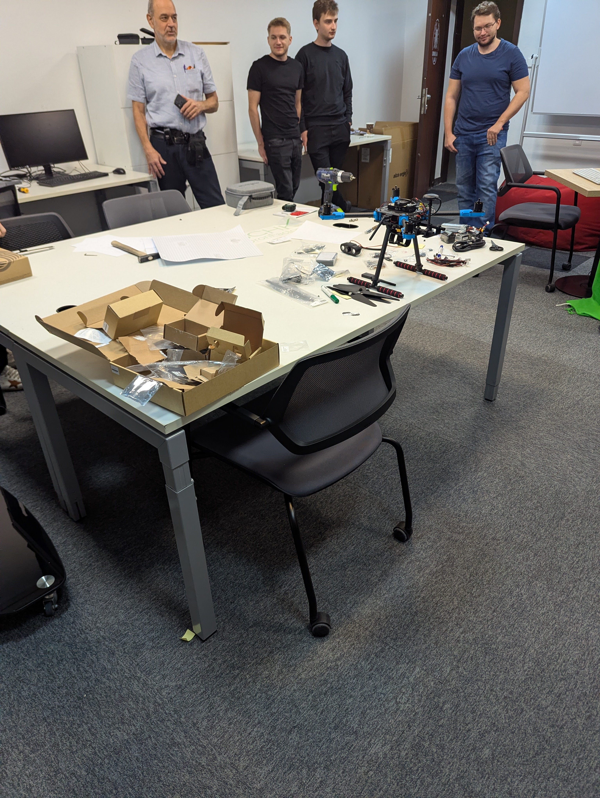
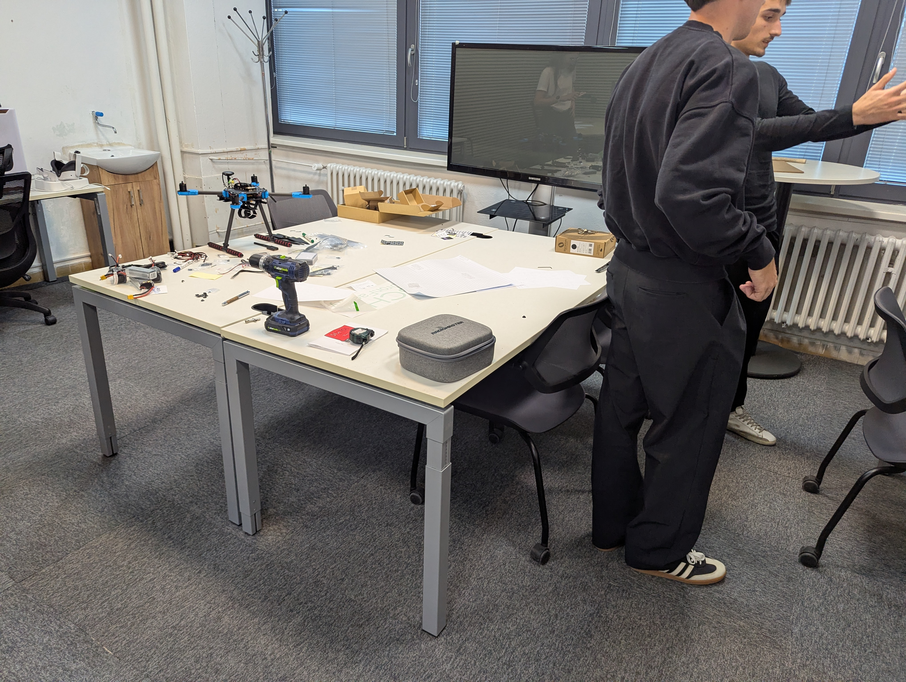
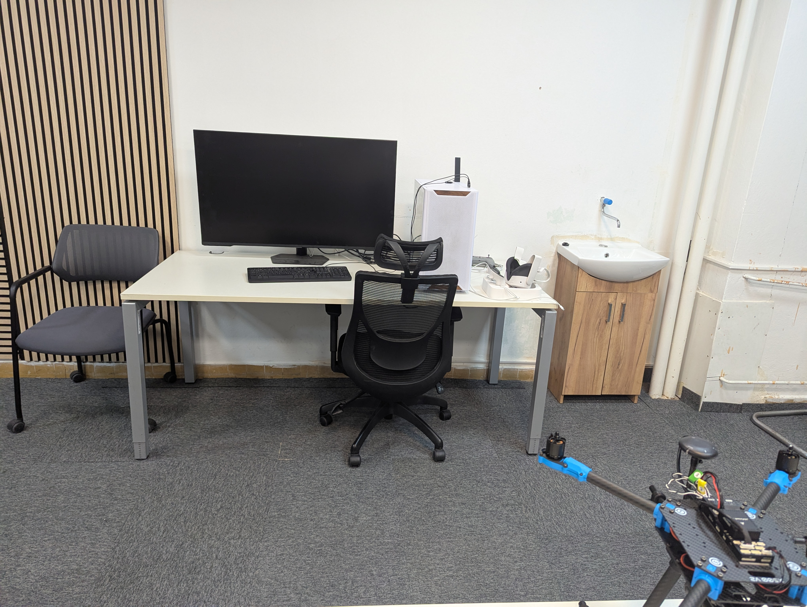
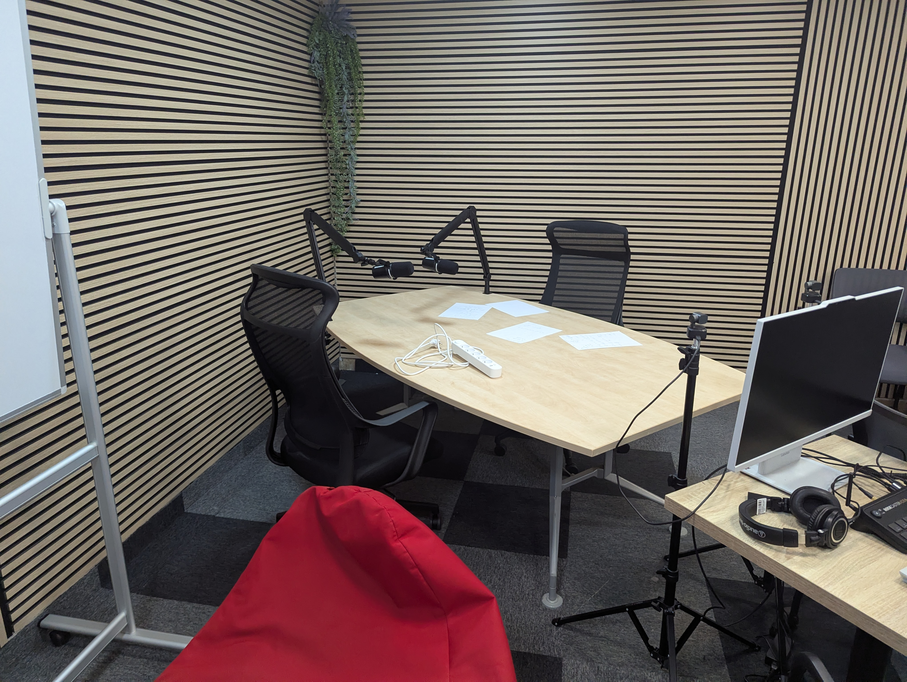

---
# 🧩 Versioning – systém dopĺňa automaticky
fm_version: "1.0.1"

# Dátum buildu – generuje skript
fm_build: "2026-10-20T14:02:18.745494+00:00"

# Poznámka k verzii – voliteľné
fm_version_comment: ""

# 🆔 IDENTITY --------------------------------------------------------

# ID generuje CLI / skript
id: "K000200"

# Unikátne UUID – generuje skript
guid: "5b175579-d4f7-45c8-bd4c-269240b5ba1c"

# 🧭 CONTEXT ---------------------------------------------------------

# DAO / doména (knife, sdlc, q12, 7ds...) dopĺňa skript
dao: "knife"

# Názov zápisu – dopĺňa používateľ
title: "K000200 – Drone lab"

# Krátky popis – dopĺňa používateľ (voliteľné)
description: "Návšteva Drone Labu FEI a FCHPT STU – otvorený priestor na stavbu, testovanie a simulácie dronov."

# 👥 AUTHORSHIP ------------------------------------------------------

# Hlavný autor – z globálneho configu
author: "Roman Kazicka"

# Zoznam autorov – generuje skript
authors:
  - "Roman Kazicka"

# 🗂 CLASSIFICATION ---------------------------------------------------

# Nadradená kategória – môže doplniť používateľ
category: ""

# Typ dokumentu (guide, case, tutorial...) – používateľ (voliteľné)
type: "case-study"

# Priorita (low/medium/high) – voliteľné
priority: ""

# Tagy – odporúča sa 2–6 tagov.
# Typy tagov:
#   - rámce: knife, 7ds, sdlc, q12
#   - účel: tutorial, guide, pattern, case-study
#   - téma: git, backup, ai, communication
#   - úroveň: beginner, intermediate, advanced
tags:
  - knife
  - case-study
  - drony
  - lab
  - beginner

# 🌍 LOCALIZATION -----------------------------------------------------

# Jazyk dokumentu – doplní skript podľa štruktúry
locale: "sk"

# 🕒 LIFECYCLE --------------------------------------------------------

# Dátum vytvorenia – generuje skript
created: "2026-10-20 16:02"

# Dátum poslednej úpravy – dopĺňa človek
modified: "2026-10-20 16:02"

# Stav dokumentu – default "backlog"
status: "backlog"

# Viditeľnosť – default "public"
privacy: "public"

# ⚖ INTELLECTUAL PROPERTY -------------------------------------------

# Držiteľ práv k obsahu – dopĺňa skript
rights_holder_content: "Roman Kazicka"

# Systémový vlastník práv
rights_holder_system: "CAA / KNIFE / LetItGrow"

# Licencia
license: "CC-BY-NC-SA-4.0"

# Disclaimer
disclaimer: "Use at your own risk. Methods provided as-is; participation is voluntary and context-aware."

# Copyright
copyright: "© 2025 Roman Kazicka"

# 🔗 ORIGIN / PROVENANCE ---------------------------------------------

# Repozitár pôvodu
origin_repo: ""

# URL pôvodného repozitára
origin_repo_url: ""

# Commit pôvodu
origin_commit: ""

# Branch pôvodu
origin_branch: ""

# Systém pôvodu (CAA/KNIFE/STHDF…)
origin_system: "CAA"

# Pôvodný autor
origin_author: "Roman Kazicka"

# Importovaný zdroj
origin_imported_from: ""

# Dátum importu
origin_import_date: ""

# 🧱 RESERVED ---------------------------------------------------------

fm_reserved1: ""
fm_reserved2: ""
---

# 🚁 Drone Lab (FEI & FCHPT STU)

## 🎯 Čo rieši (účel, cieľ)

Študenti, ktorí chcú pracovať s dronmi alebo na vlastných technických
projektoch, potrebujú priestor, nástroje a výkonnú techniku, ktorú doma
väčšinou nemajú. Drone Lab túto medzeru vypĺňa — je to **otvorený pracovný
priestor** pod záštitou Fakulty elektrotechniky a informatiky (FEI) a Fakulty
chemickej a potravinárskej technológie (FCHPT) STU.

## 🧩 Ako to rieši (princíp)

Lab spája na jednom mieste všetko, čo projekt s dronmi potrebuje:

- **fyzickú prácu** — stoly a náradie na skladanie a úpravy dronov,
- **výpočtový výkon** — pracovnú stanicu s GPU na simulácie,
- **doplnkové činnosti** — podcastové štúdio a tabule na plánovanie.

Študent tak môže prejsť od návrhu cez stavbu a simuláciu až po testovanie
bez toho, aby musel hľadať vybavenie inde.

## 🧪 Ako to použiť (aplikácia)

Lab slúži na samostatnú prácu na projektoch — navrhovanie, stavbu
a testovanie dronov, simulácie na pracovnej stanici alebo tvorbu obsahu
v podcastovom štúdiu.

---

## ⚡ Rýchly návod (Top)

| Čo | Na čo |
|---|---|
| 🚁 Drony | návrh, stavba, testovanie |
| 🕶️ Inteligentné okuliare Meta | experimenty s nositeľnou technikou |
| 🖥️ Mini server | kompaktný výpočtový uzol |
| 🎮 Pracovná stanica s NVIDIA RTX 5090 | simulácie |
| 🎙️ Podcastové štúdio | tvorba obsahu |
| 📋 Tabule | plánovanie a spoločná práca |

## 📜 Detailný článok

Navštívili sme Drone Lab, ktorý funguje pod záštitou Fakulty elektrotechniky
a informatiky (FEI) a Fakulty chemickej a potravinárskej technológie (FCHPT)
STU. Lab slúži ako otvorený pracovný priestor. Študenti v ňom môžu pracovať
na vlastných projektoch, ako aj navrhovať, stavať a testovať drony.

### Vybavenie

Počas návštevy sme si prezreli vybavenie labu. K dispozícii sú drony
a inteligentné okuliare Meta. Z výpočtovej techniky je tam kompaktný mini
server a pracovná stanica s grafickou kartou NVIDIA RTX 5090, ktorá sa
používa na simulácie.

### Podcastové štúdio a tabule

Súčasťou priestoru je aj podcastové štúdio a tabule na plánovanie
a spoločnú prácu.

## 💡 Tipy a poznámky

- Lab je otvorený priestor — dá sa využiť aj na vlastný projekt, nielen na
  výučbu.
- Simulácie sa oplatí púšťať na pracovnej stanici s RTX 5090 namiesto
  vlastného notebooku.

## ✅ Hodnota / Zhrnutie

Návšteva ukázala, že lab poskytuje technické zázemie na prácu s dronmi aj
na súvisiace činnosti, napríklad simulácie alebo tvorbu obsahu. Študenti ho
môžu využívať na samostatnú prácu na projektoch.

<!-- body:start -->

<!-- nav:knifes -->
> [⬅ KNIFES – Prehľad](../knifes_overview/KNIFE_Overview_Blog.md) • [Zoznam](../knifes_overview/KNIFE_Overview_List.md) • [Detaily](../knifes_overview/KNIFE_Overview_Details.md)
---
